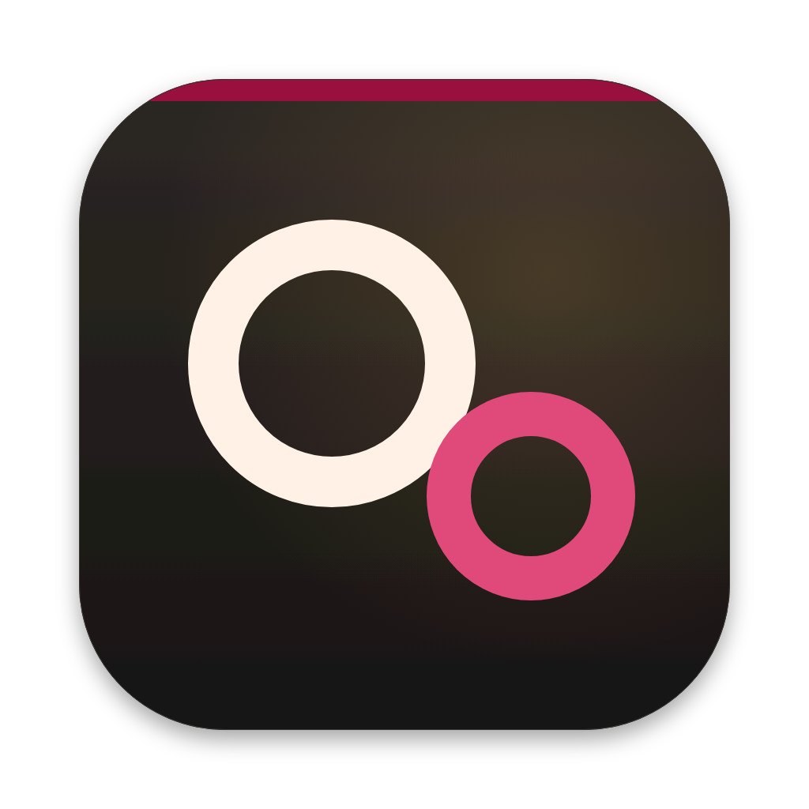
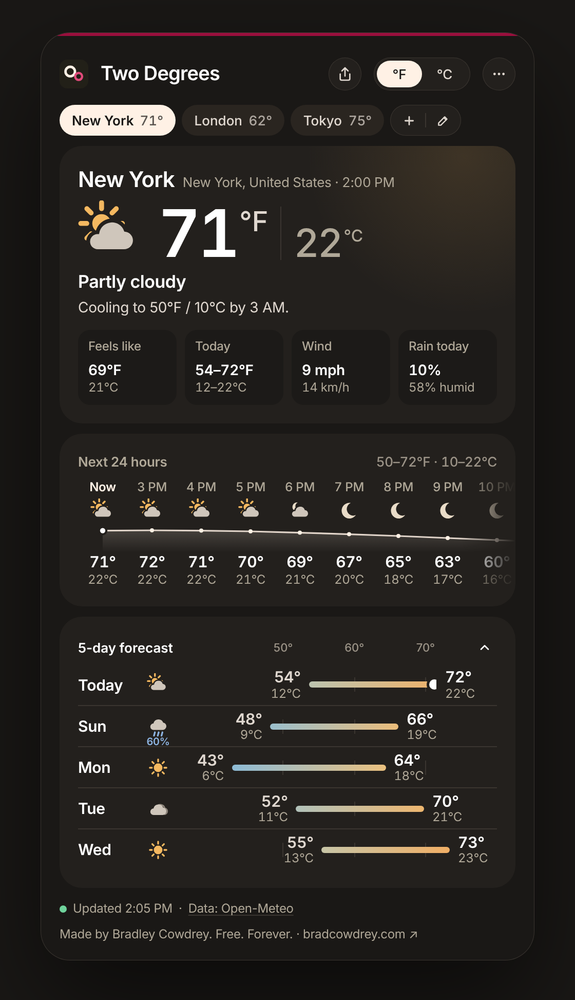
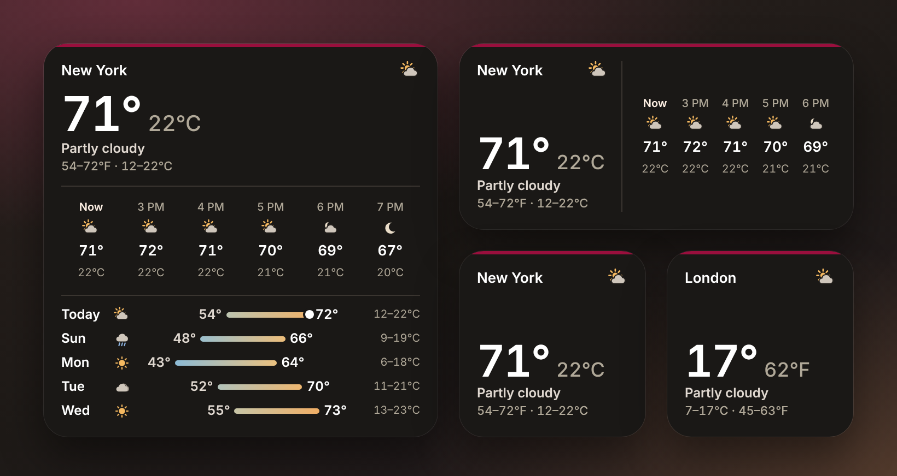

<p align="center"></p>

<h1 align="center">Two Degrees</h1>
<p align="center"><b>The weather in °F and °C at once.</b><br>
A tiny, free, open-source weather app for your Mac's Dock, menu bar and desktop widgets.<br>
Made by <a href="https://bradcowdrey.com">Bradley Cowdrey · bradcowdrey.com</a></p>

<p align="center">
  <a href="https://github.com/bradleycowdrey/two-degrees/releases/latest/download/TwoDegrees.dmg"><b>Download for Mac</b></a> ·
  <a href="https://bradcowdrey.com/two-degrees">Try it in your browser</a> ·
  <a href="#widgets">Widgets</a> ·
  <a href="CHANGELOG.md">What's new</a> ·
  <a href="https://github.com/bradleycowdrey/two-degrees/issues">Report an issue</a>
</p>

<p align="center">
  <a href="https://bradcowdrey.com/two-degrees"></a><br>
  <sub>Click the picture to try the live app at <a href="https://bradcowdrey.com/two-degrees">bradcowdrey.com/two-degrees</a> (also on <a href="https://bradleycowdrey.github.io/two-degrees/">GitHub Pages</a>).</sub>
</p>

---

Two Degrees shows every temperature twice, °F and °C side by side, so nobody has to do the math.
Pick which unit is large; the other always sits right next to it.

## What's new

- **0.3.2**: a clearer 5-day forecast. Each day's low and high sit at the ends of its bar, on one shared scale,
  in the app, the web app and the large widget.
- **On the web**: [bradcowdrey.com/two-degrees](https://bradcowdrey.com/two-degrees) is now a full product page with
  the app running in it, the [widgets live](https://bradcowdrey.com/two-degrees#widgets), and Share buttons.
- **0.3.0**: an update banner, verified updates, and the 5-day forecast as an accordion.

The app updates itself: a banner offers each new version. Every change is in the [changelog](CHANGELOG.md), and every
version is on [Releases](https://github.com/bradleycowdrey/two-degrees/releases).

## Features

- **Both units, always**: the current temperature, feels-like, today's range, every hour and every day, in °F and °C.
- **Lives in the Dock**: the Dock icon shows the live reading (`57°` over `14°C`) and the sky. Right-click it for every saved city.
- **And the menu bar**: `☁ 57° · 14°`, with the full panel one click away. Larger unit only, or icon only, if you prefer.
- **Widgets**: small, medium and large desktop / Notification Center widgets. Each picks its own city (search any place) and which unit is large. Right-click the desktop → **Edit Widgets** → search **Two Degrees**.
- **Borrowed from Meridian**: drag the menu bar panel to tear it off into a window, window position (left, centre, right), keep on top, five sizes (⌘+ / ⌘−) and SF Pro or Inter.
- **Next 24 hours**: a scrolling strip with a temperature line, icons, and rain chance when it's 20% or more.
- **5-day forecast**: lows and highs in both units, on range bars drawn to one shared, labelled scale (ticks every 10°F / 5°C), with a dot for right now.
- **One plain sentence**: "Rain likely around 3 PM (60%)" or "Warming to 68°F / 20°C by 2 PM".
- **Up to five cities**: search any place on Earth; switch with one click; Add | Edit works just like Meridian's.
- **Share**: the same Share button as Meridian and Cowdrey.MD.
- **The details**: open at login, `F` / `C` keys to swap units, VoiceOver reads both units.
- **Automatic updates** from GitHub Releases, SHA-256 verified, one click to install.
- No account, no API key, no tracking. Weather data from [Open-Meteo](https://open-meteo.com) (CC BY 4.0), refreshed every 15 minutes.

Native SwiftUI, universal binary (Apple silicon + Intel), macOS 14 Sonoma or later.

## Web app

[bradcowdrey.com/two-degrees](https://bradcowdrey.com/two-degrees) is the product page with the real app embedded in it.
Both come from this repo through GitHub Pages (`main` → `/docs`), so a push here updates the site:

- [`docs/index.html`](docs/index.html): the product page, copied from [`web/site.html`](web/site.html).
- [`docs/app.html`](docs/app.html): the app on its own (bradcowdrey.com/two-degrees/app), built from
  [`web/app.html`](web/app.html). Live Open-Meteo data, saved cities, and a share link that carries your cities
  (`?c=Denver~39.739~-104.990|London~51.507~-0.128`). Where it can't reach Open-Meteo (offline, or a sandboxed
  preview), it says so and shows a labelled sample forecast.

Edit the files in `web/`, then run `scripts/build-web.sh` to rebuild `docs/`. `node scripts/readme-shots.js` redraws the two
pictures in this README from the web app.

## Widgets

Small, medium and large widgets for your desktop and Notification Center, each with its own city and its own choice
of which unit is large: New York in °F next to London in °C, if you like. The large one adds the next six hours and the
5-day forecast.

<p align="center">
  <a href="https://bradcowdrey.com/two-degrees#widgets"></a><br>
  <sub>The widgets. See them live at <a href="https://bradcowdrey.com/two-degrees#widgets">bradcowdrey.com/two-degrees</a>.</sub>
</p>

**Add one:** open Two Degrees once, then right-click the desktop (or open Notification Center), choose **Edit Widgets**,
search for **Two Degrees**, and drag in a size. To change a widget's city or unit, right-click it and choose
**Edit "Two Degrees"**.

## Install (sideload)

Two Degrees is distributed directly, not through the Mac App Store.

1. Download [TwoDegrees.dmg](https://github.com/bradleycowdrey/two-degrees/releases/latest/download/TwoDegrees.dmg) (all versions are on [Releases](https://github.com/bradleycowdrey/two-degrees/releases)).
2. Open the DMG and drag **Two Degrees** to **Applications**.
3. First launch: if macOS says it can't verify the app, **right-click Two Degrees → Open → Open**, or run
   `xattr -dr com.apple.quarantine /Applications/TwoDegrees.app`
4. Add your cities with the **+** button.

## Build from source

Requires Xcode 16+ on macOS 14+, and [XcodeGen](https://github.com/yonaskolb/XcodeGen) for the app with its widget (`brew install xcodegen`).

```sh
git clone https://github.com/bradleycowdrey/two-degrees.git
cd two-degrees
swift run                         # run the app in development (no widget)
scripts/build-app.sh 0.2.0        # dist/TwoDegrees.app (universal, with widget)
scripts/make-dmg.sh 0.2.0         # dist/TwoDegrees-0.2.0.dmg
```

## Testing

- `swift test`: unit tests, including the updater against a stubbed network (API refused → fallback, update offered, up to date, missing or tampered checksum).
- `node tests/web.test.js [screenshots-dir]`: drives every control of the web app (`docs/app.html`) at phone, tablet and desktop widths and all five sizes (Playwright).
- `TwoDegrees --selftest <dir>`: the Mac app tests itself with live data (every size and state, cities, window positions, a real update download and checksum, Dock tile and widget renders) and writes `report.txt` and screenshots.

CI runs the unit and web tests on every pull request, and all three on every push to `main`; the self-test's report and screenshots are published to the `ci-shots` branch.

## Releasing

Bump the number in `VERSION` and push to `main`. GitHub Actions builds a universal app, packages a DMG and publishes it as release `v<VERSION>`, plus a stable `TwoDegrees.dmg` that the download links always point to.

## Inspired by

[Meteorologist](https://sourceforge.net/projects/heat-meteo/) (multiple locations in the menu bar), WeatherDock (a SwiftUI popover),
[DatWeatherDoe](https://github.com/inderdhir/DatWeatherDoe) (simple, dark-mode friendly) and [wego](https://github.com/schachmat/wego) (weather that gets out of the way).

## License

MIT. See [LICENSE](LICENSE). Inter is under the SIL Open Font License.
